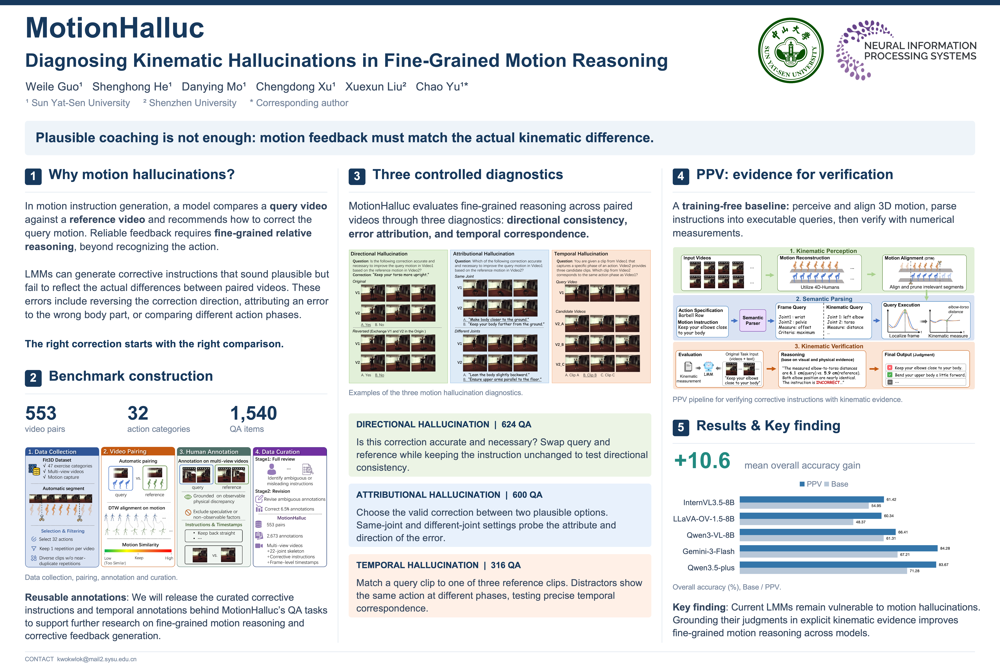

## Introduction

MotionHalluc studies kinematic hallucinations in fine-grained motion reasoning by comparing query and reference videos. The dataset includes benchmark questions for directional, attributional, and temporal hallucinations, together with the original video-pair annotations, corrective instructions, and frame annotations. The benchmark questions and original annotations are provided in [`dataset/MotionHalluc/`](dataset/MotionHalluc/). 

[[arXiv](https://arxiv.org/abs/2606.23061)]

## Installation

Use Python 3.10 or later and run the following commands from the repository root:

```bash
python -m pip install -r requirements.txt
```

Video clipping also requires the system `ffmpeg` executable. On Ubuntu or Debian, install it with:

```bash
sudo apt install ffmpeg
```

## Data Preparation

Download the source data from the [Fit3D website](https://fit3d.imar.ro/fit3d), following its access process and terms, and place it under `dataset/Fit3D/`:

```text
dataset/
├── Fit3D/
│   └── train/...
├── MotionHalluc/
│   ├── DH.json
│   ├── AH1.json
│   ├── AH2.json
│   ├── TH.json
│   └── annotation.json
└── Bench/                  # Generated benchmark video clips
```

Create the benchmark clips using the supplied manifest:

```bash
python produce_clip_from_fit3d.py --pairs bench_fit3d_pairs.txt
```


## Evaluation

### Configuration

Base evaluation uses the benchmark questions and videos. Configure an API:

```bash
export API_KEY="YOUR_API_KEY"
```


### Run Evaluation

Evaluate a single task. Replace `dh` with `ah1`, `ah2`, or `th` as needed:

```bash
python -m evaluate.run \
  --task dh \
  --api-url https://YOUR_PROVIDER/v1/chat/completions \
  --model-name YOUR_MODEL \
  --output-dir outputs/YOUR_MODEL/base/run1
```

Evaluate all tasks:

```bash
python -m evaluate.run \
  --task all \
  --api-url https://YOUR_PROVIDER/v1/chat/completions \
  --model-name YOUR_MODEL \
  --output-dir outputs/YOUR_MODEL/base/run1
```

Results are saved in task subdirectories under the specified output directory. Rerunning the same command with the same configuration skips successful predictions and retries missing or failed samples.


### Score Results

After evaluation completes, score a single task:

```bash
python -m evaluate.score \
  --task dh \
  --output-dir outputs/YOUR_MODEL/base/run1
```

Or score all tasks:

```bash
python -m evaluate.score \
  --task all \
  --output-dir outputs/YOUR_MODEL/base/run1
```


## PPV

To respect data copyright and protect privacy, we do not redistribute the motion data in this repository. Users can obtain the source data from [Fit3D](https://fit3d.imar.ro/fit3d) or reconstruct motion from videos using [4D-Humans](https://github.com/shubham-goel/4D-Humans). We provide a standalone PPV example for a query/reference video pair, with the action description, stages, correction, inputs, and API models configured in one JSON file.

### Motion Input Format

Each video requires a corresponding `.npy` array with shape `(T, 22, 3)`. The target joint order follows the [24-joint diagram](assets/24joints.jpg) with joints **22 (`L_Hand`) and 23 (`R_Hand`) removed**, preserving the order of the remaining joints.


### Configuration and Execution

Edit `ppv/config.json` to configure:

- `input`: action name, action description, stage descriptions, correction, two videos, and their two motion arrays. Video A is the query performance; video B is the reference.
- `parser` and `verifier`: independent API keys, complete Chat Completions endpoints, and model names.
- `mode`: use `ppv` for parsing, numerical measurements, and verification; use `base` for video-only verification, which does not require motion arrays or parser settings.


Run the example:

```bash
python -m ppv.run --config ppv/config.json
```

The verifier returns a concise explanation and a `yes`/`no` decision on whether the correction accurately improves video A toward video B. Each run saves `run.log` and `result.json` under the configured output directory.

## Citation

If you find this code useful for your research, please consider citing the following paper:

```bibtex
@misc{guo2026motionhalluc,
  title={{MotionHalluc}: Diagnosing Kinematic Hallucinations in Fine-Grained Motion Reasoning},
  author={Weile Guo and Shenghong He and Danying Mo and Chengdong Xu and Xuexun Liu and Chao Yu},
  year={2026},
  eprint={2606.23061},
  archivePrefix={arXiv},
  primaryClass={cs.CV},
  url={https://arxiv.org/abs/2606.23061}
}
```

